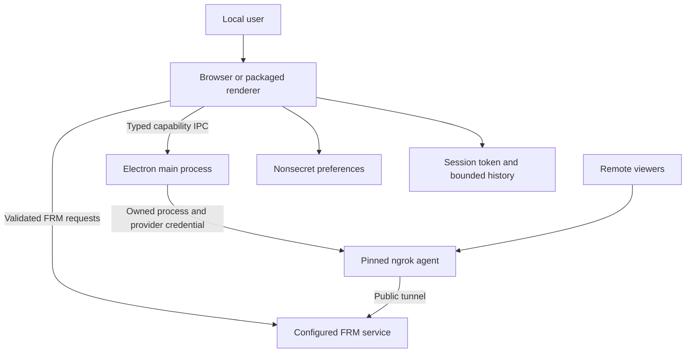

# Architecture and repository ownership

## 1. Existing system and evidence

The source has a static Next.js/React renderer, an Electron main/preload shell and an FRM HTTP API client. Browser use omits the Electron bridge. UI settings are in localStorage; historical snapshots are in process memory. ngrok exposes a selected upstream service and is independent of FRM authentication. There is no application database, custom identity service or server API in this repository. [Architecture](https://github.com/shakiata/Statusfactory/blob/d0338043169b7af80cedacd2feb838bb705b16a5/docs/architecture.md), [main process](https://github.com/shakiata/Statusfactory/blob/d0338043169b7af80cedacd2feb838bb705b16a5/electron/main.js).

The diagram describes selected target boundaries, not implemented fixes. Browser mode has no native tunnel capability. FRM and the provider are external trust domains; a public tunnel forwards the upstream API, not just the dashboard's rendered pixels. No tunnel account token belongs in the renderer or FRM headers.

## 2. Minimal proposed code changes

Keep existing panels and shared library paths. Extract helpers only where the current code duplicates security-sensitive behavior: connection parsing/token policy, bounded API requests, polling/history ownership and tunnel lifecycle. Do not move all panels into a new framework merely to match a folder tree. Add local instructions and a short README to each meaningful ownership boundary before changing it.

| Boundary / proposed path | Owner | Responsibility and allowed dependencies |
| --- | --- | --- |
| `AGENTS.md`, root `README.md` | Integrator | Entry point, commands, security policy and index; links to local guides |
| `electron/` | Desktop owner | Window/preload/IPC entrypoints and native capability enforcement; may call tunnel adapter, never import React components |
| `electron/tunnel/` (new only when extracted) | Desktop owner | One CLI adapter, process ownership, state, trusted artifact selection, redacted logs; no generic arbitrary command runner |
| `src/lib/connection/` (proposed extraction) | API/config owner | Canonical URL/profile validation, generation, token origin binding; browser-safe pure code |
| `src/lib/api.ts` + bounded request helper | API owner | One path for headers/redirects/deadlines/body/schema handling, including API Explorer and chat |
| `src/lib/useConfig.ts`, settings/theme hooks | Settings owner | Nonsecret versioned persistence, migration and Forget; no token persistence |
| `src/lib/useTimeBuffer.ts` + polling helper | Data owner | One-flight rules, bounded snapshot lifecycle, stale-generation rejection; no unowned global cache |
| `src/components/` | UI owner | Connection/security state presentation and existing shared UI; no direct raw authenticated fetch outside the client |
| `src/components/dashboard/` | Dashboard owner | 12 current feature areas share local guide; panel-specific README subsections document each data contract |
| `src/lib/__tests__/` and future boundary-local tests | Owning implementer, independent reviewer | Requirement-based fixtures and observable oracles; no production token/network dependency |
| `docs/security/` (proposed) | Security integrator | Canonical register, source facts, accepted exceptions, tests and release runbooks |
| `.agents/skills/` (future only) | Operating-kit owner | Canonical portable workflow bodies; design is in this package, not installed |
| `.opencode/agents/` and owner Codex adapter | Operating-kit owner | Small role/permission adapters, referencing canonical policy; actual-version checks mandatory |
| `.github/workflows/` (existing) | Release owner | Existing files under owner policy; no new Actions introduced |

Each concrete dashboard feature gets an ownership entry, a local documentation subsection or README and applicable AGENTS coverage; use a child directory guide only when the feature actually has a directory. Do not create 12 empty folders solely for documentation. Existing `docs/components/*.md` should be updated in place. No MCP adapter or plugin exists in the application, so none is invented.

## 3. Dependency directions and interfaces

The renderer may depend on browser-safe connection/contracts, the shared FRM client and UI primitives. The FRM client depends on parsing/validation and a fetch implementation, not dashboard state. Dashboard functions may call validators and data transforms; shared helpers must not import panels. Main process owns native capabilities and never trusts renderer validation as an authorization boundary.

The future tunnel-start interface accepts a single-use main-issued permit bound to the approved profile, origin, sender and generation, not an arbitrary executable, command line, credential or generic forwarding target. Main resolves the target and independently verifies FRM authentication through a separate fixed-endpoint probe. The narrow preload exposes only connection-select, share-authorize, tunnel-start/stop/status and status events as defined in 02 section 10; it does not expose raw `ipcRenderer`, filesystem or process methods. Requests/responses use closed schemas and bounded strings.

The main process serializes its state machine. UI state comes from authoritative tunnel results/events. Stopping a tunnel is distinct from deleting a local URL string. The connection layer independently increments its generation when origin/token changes so old data cannot make a new server appear connected. Exact contracts are in `02_DOMAIN_AND_PRODUCT_CONTRACTS.md`.

## 4. Electron content policy

Preserve `nodeIntegration: false` and `contextIsolation: true`; explicitly document sandbox/webSecurity intent without misreporting their present defaults as disabled. Validate every IPC caller's WebContents, main frame and exact expected document/origin. Block unintended navigation, window creation and unneeded permissions. A custom secure application protocol is preferred if implemented with a fixed resource root; during a narrow first repair, exact packaged-document identity can be validated instead. Do not authorize every `file:` URL or rely on prefix matching.

Generate and test a production CSP against the static export. Use hashes/approved local scripts for Next hydration rather than adding `unsafe-eval` or unrestricted remote executable sources. Dynamic styling may need a documented style-only allowance. Browser operation with user-configured FRM endpoints may require broad HTTP(S) `connect-src`; if retained for compatibility, record its residual egress risk and enforce secret binding/redirect rules in the common client. A policy header is not a replacement for those rules. Never assert that CSP prevents data theft after arbitrary renderer compromise when the connection policy is broad.

## 5. Data and configuration schema

Use a versioned nonsecret profile with an identifier, normalized endpoint, refresh interval and supported UI settings. The session secret is a separate in-memory value keyed by exact origin and generation. Configuration migration reads only known keys and bounds, drops legacy password fields, saves the new schema and removes the obsolete secret-bearing record. A migration failure cannot restore the old token as a convenience fallback.

History is transient and bounded by time, sample count and retained byte estimate; aggregated samples should replace full remote payloads where panels need only aggregates. No SQL schema/index, transaction engine or durable telemetry store is needed. Request cancellation and generation checks provide concurrency correctness for this client; idempotent Stop plus process ownership provides native lifecycle correctness.

## 6. Documentation and beginner setup

Local READMEs state purpose, inputs/outputs, commands, fixtures, errors and recovery. Root setup distinguishes a browser development server, static hosting and a packaged desktop application. The current `npm start`/`next start` script is not a valid substitute for serving a static export; verify and correct that documentation during implementation. Bind development listeners to loopback when external access is unnecessary. Keep build Node version separate from Electron's embedded Node version.

Every changed function and test needs useful comments on purpose, inputs, side effects/errors and relevant invariants. Avoid narrating obvious syntax or rewriting untouched vendor/generated files. Search for an existing helper before creating one; document why extraction/extension is needed. Root and local templates are in `templates/agent_guides.md`.

## 7. Architecture validation and expansion triggers

Verify no circular imports between panels/shared libraries, no duplicate authenticated-fetch policy, no renderer-to-native generic capability and no hidden provider credential path. Recheck packaging contents after dependency changes. Add a service only if a new authorized product requirement cannot be satisfied by the existing local client; factory size alone should first trigger bounded data/aggregation improvements, not infrastructure expansion.
